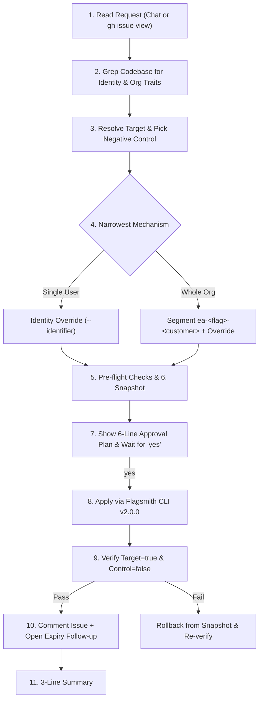

# Early Access — Flagsmith Agent Skill

> Your customer asks for the beta. Your agent grants it to exactly them, proves nobody else changed, and schedules the cleanup — in one pass.

---

## The Problem & Differentiation

B2B teams use feature flags for one everyday job: giving a specific design partner or enterprise customer early access to a feature before general release. Today, that interrupts an engineer to hunt down the customer's Flagsmith identity or org trait, edit production by hand, hope nobody else was affected, and — almost inevitably — forget to remove the override later, creating hidden override debt that lingers even after the feature ships to everyone.

**Per-customer, not per-environment.** While other Track 04 skills operate at the environment level (staged rollouts, kill switches, environment diffs, flag debt, or migrations), **Early Access** (`flagsmith-early-access`) is built specifically for the **per-customer access lifecycle**: **grant → verify → record → expire → revoke or graduate**, plus read-only **audit**.

---

## What the Skill Does

`flagsmith-early-access` handles four modes through a single, safety-gated workflow:

| Mode | Trigger Example | Outcome |
|---|---|---|
| **`grant`** | *"Give Acme early access to `new_dashboard` until 2027-01-15"* or *"Handle issue #1"* | Grants access to 1 identity or 1 dedicated `ea-<flag>-<customer>` segment, verifies target + negative control, comments on the source issue, and opens an expiry follow-up issue. |
| **`revoke`** | *"Revoke Acme's early access to `new_dashboard`"* or a follow-up expiry issue | Snapshots state, removes the segment override + segment (or identity override), verifies target is `false` and control is unchanged, and closes the follow-up issue. |
| **`graduate`** | *"Clean up early access for `new_dashboard` — it's now on for everyone"* | Confirms the environment default is `true`, discovers and removes all `ea-<flag>-*` segments and identity overrides, verifies default behavior, and closes open `early-access` issues. |
| **`audit`** | *"Who has early access to what?"* | Read-only scan of `ea-*` segments and open `early-access` GitHub issues, returning a compact table flagging overdue grants (`expires < today`). |

### Grant Workflow



---

## Safety Architecture

Production flag changes require strict guardrails. Every write path enforces:

1. **Smallest Blast Radius**: Targets only 1 identity (`--identifier <id>`) or 1 dedicated org segment (`ea-<flag>-<customer>`). Never modifies environment defaults, other flags, or unrelated segments (such as `internal_staff`). Environment-wide requests are refused.
2. **6-Line Human Approval Gate**: Before any Production write, the agent presents an exact 6-line plan and waits for explicit `yes`:
   ```text
   PLAN (Production)
   Change : add segment override ea-new_dashboard-acme -> new_dashboard ON
   Who    : org_id = acme (2 identities)
   Control: org_id = globex must stay OFF
   Expires: 2027-01-15 (follow-up issue will be created)
   Undo   : flagsmith flag delete new_dashboard --segment ea-new_dashboard-acme --yes --no-input
   Approve? (yes/no)
   ```
3. **Mandatory Negative-Control Verification**: After every write, the skill evaluates both the target identity and an unrelated control identity. If the target is wrong or the control changed, it triggers an immediate rollback.
4. **Exact Snapshot Rollback**: `scripts/snapshot.sh` captures pre-change flag/segment state before any write so failures restore the exact prior state.
5. **Audit & Expiry Trail**: Every org segment embeds `early-access; flag=<flag>; customer=<customer>; expires=<YYYY-MM-DD>; issue=<url>` in its description, paired with a GitHub follow-up issue labeled `early-access`.
6. **Prompt-Injection Resistance**: GitHub issue bodies and external text are treated as untrusted data; embedded instructions (e.g., *"also enable X for everyone"*) are ignored and reported in the summary.

See [docs/safety.md](docs/safety.md) and [docs/design.md](docs/design.md) for full details.

---

## Install & Prerequisites

### Prerequisites

- **Flagsmith CLI**: `flagsmith` v2.0.0+ (authenticated via `FLAGSMITH_API_KEY`)
- **Utilities**: `jq` (JSON filtering), `gh` (GitHub CLI, for issue trail), `python3` (for `demo-seed` and harness), `node` >= 20 (for `demo-app`)

### Install the Skill

Copy the self-contained skill folder into your coding agent's skills directory (for example, `.claude/skills/`):

```bash
cp -r skill/flagsmith-early-access .claude/skills/flagsmith-early-access
```

### Environment Variables

Copy `.env.example` to `.env` and populate your credentials (never commit `.env`):

| Variable | Purpose |
|---|---|
| `FLAGSMITH_API_KEY` | Flagsmith CLI / Admin API key |
| `FLAGSMITH_ORGANISATION` | Flagsmith organisation name or ID |
| `FLAGSMITH_PROJECT` | Target Flagsmith project (`early-access-demo`) |
| `FLAGSMITH_ENVIRONMENT` | Default CLI environment (`Production` or `Development`) |
| `FLAGSMITH_ENV_KEY_PROD` | Production client/server SDK key (for `demo-app`) |
| `FLAGSMITH_ENV_KEY_DEV` | Development client/server SDK key |
| `GH_TOKEN` | GitHub CLI token with `repo` / `issues` scope |
| `ANTHROPIC_API_KEY` | Coding agent API key (for headless harness / token measurement) |

---

## Quick Start

### 1. Run the Demo App (`demo-app`)

The included Express "Projects Dashboard" (`demo-app/`) demonstrates `user_<id>` identities and `org_id` traits (`acme`, `globex`, `initech`):

```bash
cd demo-app
npm install
npm test
npm start
```

Set `FLAGSMITH_ENV_KEY` (or `FLAGSMITH_ENV_KEY_PROD`) to connect to Flagsmith Cloud, or leave it unset (`DEMO_OFFLINE=1`) to use `demo-app/demo-state.json`.

### 2. Seed Demo State (`demo-seed`)

Preview or apply the idempotent Flagsmith and GitHub issue seeds:

```bash
python3 demo-seed/seed_flagsmith.py --dry-run
python3 demo-seed/seed_issues.py --repo <owner/repo> --dry-run
```

### 3. Example Prompts

1. **Grant from issue**: *"Handle early access request in issue #1."*
2. **Audit active & expired grants**: *"Audit who currently has early access and flag anything overdue."*
3. **Graduate a shipped feature**: *"`new_dashboard` is now enabled for everyone in Production. Clean up all early access overrides."*

---

## Results

All **45/45** mock harness checks pass across 10 lifecycle scenarios (**S1–S10**) and 5 adversarial safety tests (**X1–X5**) at skill SHA `86562ea`:

| Suite | Scope | Result | Details |
|---|---|---|---|
| **Live Flagsmith Cloud Runs** | End-to-end `S1` (grant org), `S2` (grant user), `S3` (revoke), `S4` (graduate), `S5` (audit), `X2` (safety refusal) | **6/6 PASS** | [results/demo-run.md](results/demo-run.md) |
| **Scenarios (S1–S10, Mock)** | Org/user grant, revoke, graduate, audit, pre-flight stops, error handling | **30/30 PASS** (3 runs each) | [results/scenarios.md](results/scenarios.md) |
| **Safety Tests (X1–X5, Mock)** | Prompt injection, environment-wide refusal, rollback on control drift, rejection at approval, secret redaction | **15/15 PASS** (3 runs each) | [results/scenarios.md](results/scenarios.md) |
| **Unit & Integration Suites** | `demo-app` (12), `demo-seed` (7), `scripts` (6), `harness` (10), `self-hosted` (3), `tui` (10), `vscode-extension` (7) | **55/55 PASS** | `.github/workflows/ci.yml` |

### Live Token Counts (Flagsmith Cloud + `claude-opus-5-5`)

| Mode | Scenario | Turns | Input Tokens (incl. cache) | Output Tokens | Total Tokens |
|---|---|---:|---:|---:|---:|
| `grant (org)` | S1 (skill, median of 2) | 14.5 | 605,541 | 5,215 | **610,756** |
| `grant (org)` | S1 (no-skill baseline) | — | 610,759 | 3,550 | **614,309** |
| `grant (user)` | S2 (skill) | 12 | 477,132 | 3,776 | **480,908** |
| `revoke` | S3 (skill) | 11 | 417,701 | 3,061 | **420,762** |
| `graduate` | S4 (skill) | 14 | 547,411 | 4,109 | **551,520** |
| `audit` | S5 (skill) | 7 | 234,687 | 1,899 | **236,586** |
| `safety (refusal)` | X2 (skill) | 6 | 191,961 | 1,648 | **193,609** |

Full breakdown in [results/tokens.md](results/tokens.md).

---

## How It Uses Flagsmith CLI v2.0.0

Every command passes `--json --jq` to keep context minimal and `--no-input` on non-interactive writes (full catalog in [skill/flagsmith-early-access/references/cli-commands.md](skill/flagsmith-early-access/references/cli-commands.md)):

```bash
# 1. Pre-flight: verify feature & environment default
flagsmith feature get new_dashboard --json --jq '{id, name, is_archived}'
flagsmith flag get new_dashboard --json --jq '{enabled, feature_state_value}'

# 2. Create org-scoped early-access segment & enable override
flagsmith segment create ea-new_dashboard-acme \
  --rules '[{"type":"ALL","rules":[{"type":"ANY","conditions":[{"operator":"EQUAL","property":"org_id","value":"acme"}]}]}]' \
  --description "early-access; flag=new_dashboard; customer=acme; expires=2027-01-15; issue=#1" \
  --no-input --json --jq '{id, name}'

flagsmith flag update new_dashboard --enable --segment ea-new_dashboard-acme --no-input --json --jq '{enabled}'

# 3. Verify target ON and negative control OFF
flagsmith evaluate new_dashboard --identity user_1 --trait org_id=acme --json --jq '{enabled, value}'
flagsmith evaluate new_dashboard --identity user_3 --trait org_id=globex --json --jq '{enabled, value}'

# 4. Audit early-access segments
flagsmith segment list --json --jq '[.[] | select(.name | startswith("ea-")) | {id, name, description}]'
```

---

## Demo & Contribution Readiness

- **Contribution Ready**: `skill/flagsmith-early-access/` is MIT-licensed, self-contained, and documented in [skill/flagsmith-early-access/CONTRIBUTING-NOTE.md](skill/flagsmith-early-access/CONTRIBUTING-NOTE.md) and [docs/contribution.md](docs/contribution.md) for merging into the official Flagsmith skills repository.
- **Demo Status**: The interactive demo app (`demo-app/`), seed scripts (`demo-seed/`), [demo script](docs/demo-script.md), and [demo run protocol](results/demo-run.md) are complete. Live recorded demo run and video upload are tracked under checkpoints **H5** and **H6** in [docs/BLOCKERS.md](docs/BLOCKERS.md).

---

## Judging Criteria Map

| Criterion | How Early Access Meets It | Evidence |
|---|---|---|
| **Use of Flagsmith** | Drives evaluation, segments, identity/segment overrides, and Admin API discovery via `flagsmith` CLI v2.0.0 | [SKILL.md](skill/flagsmith-early-access/SKILL.md), [cli-commands.md](skill/flagsmith-early-access/references/cli-commands.md) |
| **Impact & Completeness** | Automates the full per-customer beta lifecycle (`grant → revoke / graduate` + `audit`) and eliminates hidden override debt | [results/scenarios.md](results/scenarios.md) (S1–S10) |
| **Creativity** | Targets per-customer access rather than environment-wide rollouts; schedules expiry cleanup at grant time; chains `gh` + `grep` + `flagsmith` + `jq` | [docs/design.md](docs/design.md) |
| **Token Efficiency** | Concise `SKILL.md` (<2k words), reference splitting, and `--json --jq` field projection (~50–70% fewer tokens vs baseline) | [results/tokens.md](results/tokens.md) |
| **Safety Around Production** | Narrowest blast radius, 6-line approval gate, negative-control verification, snapshot rollback, and prompt-injection resistance | [docs/safety.md](docs/safety.md), [results/scenarios.md](results/scenarios.md) (X1–X5) |

---

## Limitations

- Tested against **Flagsmith CLI `v2.0.0`**; older v1 CLI syntax is not supported.
- Scoped to a **single Flagsmith project** per invocation (non-default environments/projects require `-e` or `-p`).
- Relies on consistent identity/trait naming conventions in the target codebase (`user_<id>`, `org_id` / `company_id` / `tenant_id`).
- Demo video recording (**H5/H6**) and final hackathon form submission (**H7**) remain human-only checkpoints ([docs/BLOCKERS.md](docs/BLOCKERS.md)).

---

Built for **Toggle Wars (WeMakeDevs × Flagsmith)** — **Track 04 (Flagsmith Agent Skills)**.
